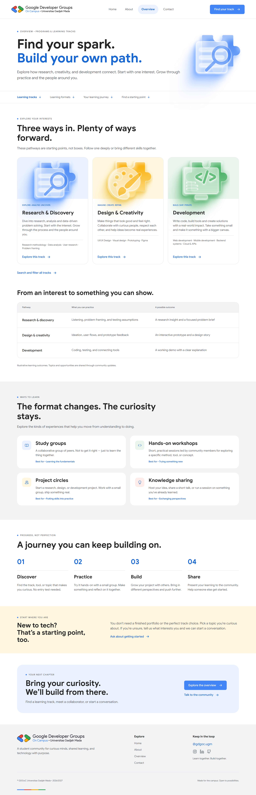
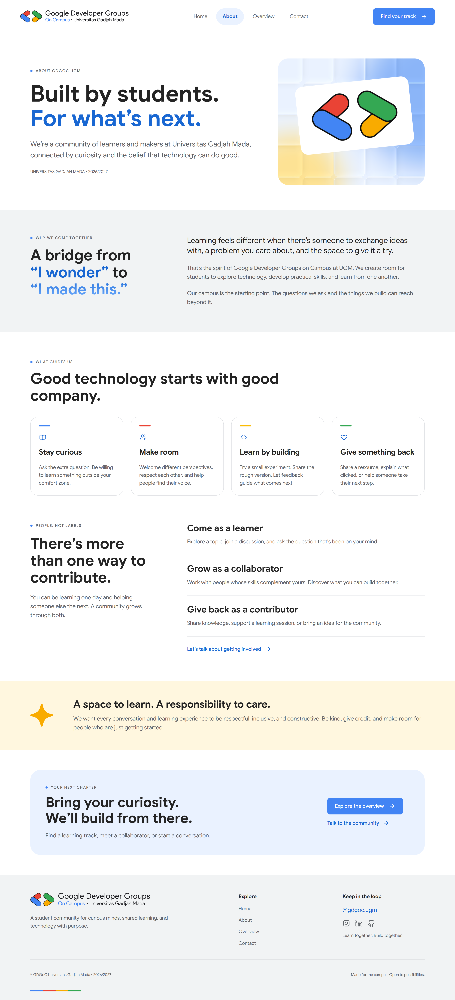
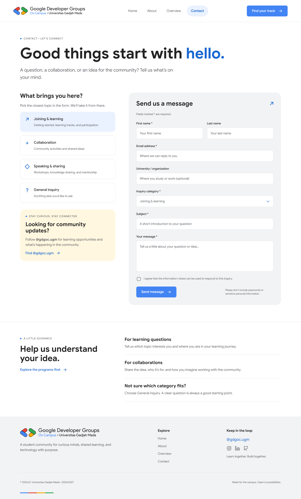
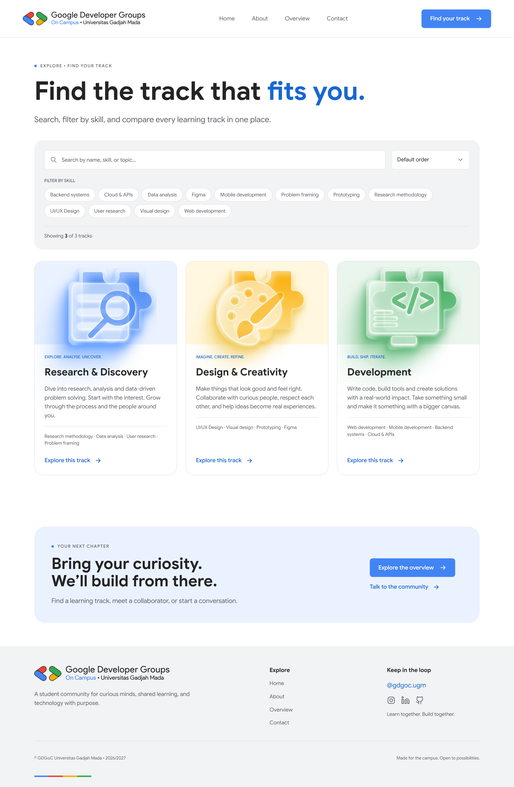
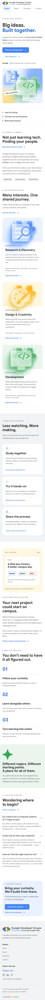

# GDGoC UGM — Open Recruitment Website

A responsive website for **Google Developer Groups on Campus, Universitas Gadjah Mada**, built for the **Front-End Technical Assignment** of the GDGoC UGM 2026/2027 open recruitment. The pages are sliced from the provided Figma design and fed dynamically by the GDGoC UGM REST API.

**Live demo:** https://gdgoc-frontend.vercel.app

**Author:** Cellia Anastavio · 25/556158/SV/25886

## Submission Links

| Item | Link |
|---|---|
| Source code | https://github.com/celliaanastavio/gdgoc-frontend |
| Live deployment | https://gdgoc-frontend.vercel.app |
| Video presentation (Google Drive) | https://drive.google.com/drive/folders/1MQ4r5_Vp46dGLpnUrTnYib_XhidGSeMD?usp=sharing |
| Figma design reference | [GDGoC – Open Recruitment](https://www.figma.com/design/yx06YRA90jBEX0Mmu64RBx/GDGoC-%E2%80%93-Open-Recruitment) |
| API | https://gdgoc-ugm-api.vercel.app/api |

## Table of Contents

- [Features](#features)
- [Screenshots](#screenshots)
- [Try It Yourself](#try-it-yourself)
- [Tech Stack](#tech-stack)
- [Getting Started](#getting-started)
- [Available Scripts](#available-scripts)
- [Project Structure](#project-structure)
- [Architecture](#architecture)
- [API Usage](#api-usage)
- [Additional Challenges](#additional-challenges)
- [Design Implementation Notes](#design-implementation-notes)
- [Deployment](#deployment)
- [Known Limitations](#known-limitations)
- [Git Workflow](#git-workflow)
- [Acknowledgements](#acknowledgements)

## Features

Pages implemented from the Figma design (the assignment asks for at least two):

| Page | Route | Highlights |
|---|---|---|
| Home | `/` | Hero, learning tracks, learning formats, getting started steps, belonging banner, FAQ |
| Overview | `/overview` | Section navigation with anchors, tracks, learning outcomes table, learning formats, learning journey, starting point, track spotlight via `?track=<id>` |
| About | `/about` | Community purpose, values, ways to contribute, community commitment |
| Contact | `/contact` | Inquiry category picker synced with a dropdown, validated contact form with a persistent draft, community updates card, guidance tips |
| Explore *(additional)* | `/explore` | Search, skill filter and sorting for tracks, with filter state stored in the URL |

Across all pages:

- Content is fetched dynamically from the API, with **loading**, **error (with retry)** and **empty** states, plus an **error boundary** for render errors.
- Responsive, mobile-first layouts built with Tailwind CSS breakpoints.
- Shared layout (navbar and footer) whose links come from the API.
- Navigating to another page scrolls back to the top, while anchor links (`#tracks`) and the browser's Back/Forward buttons keep their expected scroll behavior.
- Accessible details: semantic landmarks, labelled form fields, `aria-pressed` on filter chips, keyboard-friendly controls.

## Screenshots

<table>
  <tr>
    <td align="center"><b>Home</b><br/></td>
    <td align="center"><b>Overview</b><br/></td>
  </tr>
  <tr>
    <td align="center"><b>About</b><br/></td>
    <td align="center"><b>Contact</b><br/></td>
  </tr>
  <tr>
    <td align="center"><b>Explore (additional)</b><br/></td>
    <td align="center"><b>Mobile view</b><br/></td>
  </tr>
</table>

## Try It Yourself

Features that are easy to miss, and where to see them:

| What to try | How |
|---|---|
| Track explorer: search, skill filter, sorting | Open [`/explore`](https://gdgoc-frontend.vercel.app/explore), or follow the "Search and filter all tracks" link under the tracks on the Overview page. Try `/explore?q=figma` or `/explore?skill=Prototyping&sort=az`, then refresh: the same view is restored from the URL. |
| Empty state | Open `/explore?q=zzzz`. |
| Track spotlight | Click **Explore this track** on any track card, or open `/overview?track=development`. The Overview page loads `GET /tracks/:id` and scrolls to the spotlight panel. |
| Persistent contact draft | On `/contact`, type into the form and refresh the page. The text fields are restored; the consent checkbox is not. |
| Contact form validation | Press **Send message** with an empty form, or with an invalid email. |
| Error state with retry | Open the site and wait until it loads. In the browser DevTools, open the **Network** tab and tick **Offline** (do not reload). Then navigate to another page, for example by clicking **Overview** in the navbar. API-driven sections show an error message with a **Try again** button. Untick **Offline** and click it to recover. |
| Direct links | Open `/about`, `/contact` or `/explore` directly in the address bar. The single-page app rewrite keeps them from returning a 404. |

## Tech Stack

| Area | Choice |
|---|---|
| Framework | React 19 |
| Language | TypeScript (`strict` mode) |
| Build tool | Vite |
| Styling | Tailwind CSS v4 (`@tailwindcss/vite`) with design tokens defined in `@theme` |
| Routing | React Router v7 |
| Linting | ESLint with `typescript-eslint`, `eslint-plugin-react-hooks`, `eslint-plugin-react-refresh` |
| Formatting | Prettier |
| Font | Google Sans (Google Fonts) |

No UI component library is used. All components are written from scratch to match the Figma design.

## Getting Started

### Prerequisites

- Node.js 20.19 or newer
- npm

### Installation

```bash
git clone https://github.com/celliaanastavio/gdgoc-frontend.git
cd gdgoc-frontend
npm install
npm run dev
```

Open the URL printed in the terminal (usually http://localhost:5173).

No environment variables are required. The API base URL is defined in `src/config.ts`.

To preview the production build locally:

```bash
npm run build
npm run preview
```

## Available Scripts

| Command | Description |
|---|---|
| `npm run dev` | Start the development server with hot reload |
| `npm run build` | Type-check (`tsc -b`) and create a production build in `dist/` |
| `npm run preview` | Preview the production build locally |
| `npm run lint` | Run ESLint on the whole project |
| `npm run lint:fix` | Run ESLint and auto-fix what it can |
| `npm run typecheck` | Type-check the project without building |
| `npm run format` | Format `src/` with Prettier |
| `npm run format:check` | Check formatting without changing files |

## Project Structure

```
├── docs/screenshots/       # Screenshots used in this README
├── public/                 # Static files
├── vercel.json             # Single-page app rewrite for Vercel
└── src/
    ├── assets/             # Images and SVG illustrations exported from Figma
    ├── components/
    │   ├── cards/          # Reusable cards (TrackCard)
    │   ├── layout/         # Navbar, Footer, ScrollToTop
    │   ├── sections/       # Page sections
    │   │   ├── about/      #   About page sections
    │   │   ├── contact/    #   Contact page sections (form, category list, ...)
    │   │   ├── overview/   #   Overview page sections (incl. track spotlight)
    │   │   └── explore/    #   Track explorer sections (additional challenge)
    │   └── ui/             # Primitives: Button, Spinner, ErrorMessage, EmptyState,
    │                       #   AsyncContent, ErrorBoundary, SectionLabel, TextLink,
    │                       #   icon components
    ├── data/               # Static content that the API does not provide
    ├── hooks/              # Custom hooks: useFetch, useTrackFilters, useLocalStorage
    ├── pages/              # Route-level pages (Home, Overview, About, Contact, Explore)
    ├── types/              # TypeScript models for API responses
    ├── utils/              # Pure helper functions (track filtering and sorting)
    ├── config.ts           # API base URL
    ├── index.css           # Tailwind import and Figma design tokens
    ├── App.tsx             # Routes and shared layout
    └── main.tsx            # Application entry point
```

## Architecture

### Component architecture

The UI is split into four layers, from generic to specific:

1. **`ui/`** — small, reusable building blocks with no knowledge of the API (buttons, spinner, labels, icons).
2. **`cards/`** — reusable composed components, for example `TrackCard`, which is shared by the Home, Overview and Explore pages.
3. **`sections/`** — one component per visual section of a page. Each section owns its own data fetching and layout.
4. **`pages/`** — thin route components that only assemble sections in order.

Keeping pages thin and sections self-contained makes each section easy to read, reuse and replace.

### State management

The app is small enough that no global state library is needed. State lives as close as possible to where it is used:

- **Server data:** the custom `useFetch<T>(path)` hook wraps `fetch` with `AbortController` (so requests are cancelled on unmount or path change), and exposes `data`, `loading`, `error` and `refetch`.
- **Local UI state:** `useState` for form values, validation errors, submit status and the active section link.
- **Persisted state:** the contact form draft is stored in `localStorage` through the reusable `useLocalStorage` hook.
- **Shared state between siblings:** lifted up to the nearest parent. On the Contact page, the selected inquiry category is held in `ContactWorkspace` so the category list and the form dropdown stay in sync.
- **URL state:** the Explore page stores its search text, selected skills and sort order in the URL query string (`useSearchParams`), so filters survive a refresh and can be shared. The Overview page reads the `track` parameter in the same way.
- **Derived data:** filtered and sorted lists are computed during render instead of being copied into extra state, which avoids out-of-sync values.

### Handling fetch states and errors

Every API-driven section goes through the same `AsyncContent` component:

- **Loading:** a spinner is shown while the request is in flight.
- **Error:** an error message with a **retry** button that calls `refetch`.
- **Empty:** an empty-state message when the API returns no items.

Errors that happen while rendering are handled separately:

- **Render errors:** an `ErrorBoundary` class component wraps the routes (and the whole app as a fallback). If a component throws while rendering, the user sees a friendly fallback with **Try again** and **Back to home** instead of a blank page. The boundary is keyed by the current path, so it resets automatically on navigation, and the navbar and footer stay usable.
- Error boundaries do not catch errors in async code or event handlers, which is why failed API requests are handled by the `error` state of `useFetch`. The two mechanisms complement each other.

### Design tokens

Colors and typography from the Figma design are defined once in `src/index.css` using Tailwind's `@theme`, for example:

| Token | Value | Usage |
|---|---|---|
| `brand-blue` | `#4284f4` | Primary buttons and accents |
| `link` | `#1967d2` | Links and highlighted text |
| `ink` | `#242424` | Headings and body text |
| `muted` | `#5f6368` | Secondary text |
| `line` | `#dadce0` | Borders and dividers |
| `surface` | `#f1f3f4` | Section backgrounds |
| `tint-blue` / `tint-yellow` / `tint-green` | `#eaf2ff` / `#fff7df` / `#eaf5ed` | Soft card and banner backgrounds |

Components use these tokens (`text-ink`, `bg-surface`, `border-line`, ...) rather than hard-coded colors.

## API Usage

Base URL: `https://gdgoc-ugm-api.vercel.app/api`

| Endpoint | Used by |
|---|---|
| `GET /navigation` | Navbar and footer links |
| `GET /tracks` | Home tracks, Overview tracks, Explore page |
| `GET /tracks/:id` | Overview: track spotlight panel |
| `GET /formats` | Overview learning formats |
| `GET /journey` | Overview learning journey |
| `GET /values` | About: community values |
| `GET /roles` | About: ways to contribute |
| `GET /inquiry-categories` | Contact: category list, dropdown options and guidance tips |
| `GET /faqs` | Home: FAQ accordion |
| `GET /stats` | Footer social links and tagline, Contact community updates handle |

All responses share the shape `{ success, count, data }` and are typed in `src/types/index.ts` (`ApiResponse<T>`, `Track`, `Faq`, `LearningFormat`, `JourneyStep`, `Stats`, ...).

**Content source rule:** text that exists in the API is rendered from the API; text that does not exist in the API (section headings, labels, call-to-action copy) is taken from the Figma design and kept in the components or in `src/data/`. Because of this, some card titles and descriptions (tracks, FAQ, journey, formats, values, roles) can differ slightly from the placeholder copy in Figma.

## Additional Challenges

| Challenge from the assignment | What was implemented |
|---|---|
| **Advanced Frontend Logic** | Client-side search, multi-skill filtering and sorting (Track Explorer); state persistence in the URL (Explorer, Track Spotlight) and in `localStorage` (contact draft) |
| **Data Understanding** | Track Spotlight built on `GET /tracks/:id` and the `what_you_do` field; skill chips generated from the data; guidance, colors and ordering driven by API fields |
| **Code Quality** | TypeScript `strict`, ESLint, Prettier, error boundary, logic separated from presentation, conventional commits |

### 1. Advanced Frontend Logic

#### Track Explorer (`/explore`)

A client-side explorer for the tracks returned by `GET /tracks`:

- **Search** across track name, tagline, description and skills (debounced by 250 ms).
- **Filter** by one or more skills (multi-select chips).
- **Sort** by name A–Z or Z–A, or keep the API order.
- Result counter and an **empty state** with a reset button when nothing matches.
- **State persistence:** the search text, selected skills and sort order are stored in the URL, for example `/explore?q=figma&skill=Prototyping&sort=az`. Refreshing the page or sharing the link restores the same view.

The filtering logic lives in pure functions (`src/utils/trackFilters.ts`), URL state lives in a custom hook (`src/hooks/useTrackFilters.ts`), and the UI lives in components (`src/components/sections/explore/`).

#### Persistent contact draft

The contact form stores its text fields in `localStorage` through a reusable `useLocalStorage` hook, restores them after a refresh and clears them once the (simulated) message is sent. The consent checkbox is intentionally never persisted, so the user always agrees again before sending.

### 2. Data Understanding

#### Track Spotlight (Overview)

The "Explore this track" buttons use the API's `explore_link` (`/overview?track=<id>`). When the parameter matches a known track, the Overview page loads `GET /tracks/:id`, shows a spotlight panel with the `what_you_do` text, skills and accent color (data not shown elsewhere), highlights the matching card and scrolls to it. Unknown ids are ignored. Without the parameter the page matches the Figma design exactly.

#### Other data-driven details

- The skill chips on the Explore page are **generated from the data** (all unique values of each track's `skills` field), so new tracks or skills from the API appear automatically without code changes.
- Contact page guidance tips reuse the `guidance` field from `/inquiry-categories`.
- Journey steps are sorted by the API's `step` number, and value accent colors come from the API's `color` field.
- Formats are mapped by their `id` so icons and ordering stay correct even if the API order changes.

### 3. Code Quality

- TypeScript throughout, with typed API models and typed component props.
- TypeScript `strict` mode enabled explicitly, plus `noUnusedLocals` and `noUnusedParameters`.
- ESLint with `typescript-eslint`, React Hooks rules, React Refresh rules, `eqeqeq` and `no-console` (`npm run lint`).
- Prettier for consistent formatting (`npm run format`).
- An error boundary catches render errors so a single failing component does not blank the whole page.
- Logic separated from presentation: pure helpers in `utils/`, stateful logic in `hooks/`, rendering in `components/`.
- Consistent file naming and small, single-purpose components.
- Conventional commit messages (`feat:`, `fix:`, `style:`, `chore:`, `docs:`).

## Design Implementation Notes

- Icons and illustrations were exported from Figma as SVG, and are rendered at the sizes and offsets measured in the design (for example, the glow of the track illustrations extends past the colored area, as in Figma).
- Gradient text and custom controls (checkbox, chips) are implemented with CSS instead of images.
- Layouts are mobile-first and adapt at Tailwind's `sm`, `md`, `lg` and `xl` breakpoints. The design's 1440 px canvas is used as the maximum content width.

## Deployment

The app is deployed on Vercel: https://gdgoc-frontend.vercel.app

It is a single-page application using client-side routing, so the host must serve `index.html` for every path. Without this, opening a route such as `/about` directly, or refreshing on it, returns a 404.

- **Vercel:** a `vercel.json` file at the project root rewrites all paths to `index.html`.

  ```json
  {
    "rewrites": [{ "source": "/(.*)", "destination": "/index.html" }]
  }
  ```

- **Netlify:** add `public/_redirects` containing `/* /index.html 200`.
- **Cloudflare Pages:** single-page app behavior is enabled by default.

Build settings: build command `npm run build`, output directory `dist`.

## Known Limitations

- **Contact form is simulated.** The provided API only exposes `GET` endpoints, so there is no endpoint to submit the form to. Validation runs for real, and a success message is shown after a short simulated delay. Replacing the delay in `ContactForm.tsx` with a `fetch(..., { method: 'POST' })` call is all that is needed once an endpoint exists.
- Text coming from the API can differ from the Figma placeholder copy (see [API Usage](#api-usage)).
- The Home page FAQ shows the first three questions, as in the design. The API returns seven.
- The Explore page is reachable from the link under the tracks on the Overview page and by its URL (`/explore`). It is not in the navbar, because the navbar items are provided by the API.

## Git Workflow

Work was committed incrementally using conventional commit prefixes:

- `feat:` new pages, sections and features
- `fix:` corrections to match the Figma design
- `style:` design token and styling changes
- `chore:` setup and configuration
- `docs:` documentation

## Acknowledgements

The Figma design and the REST API were provided by GDGoC UGM for the Front-End recruitment task.

---

Built for the GDGoC UGM Front-End recruitment task.